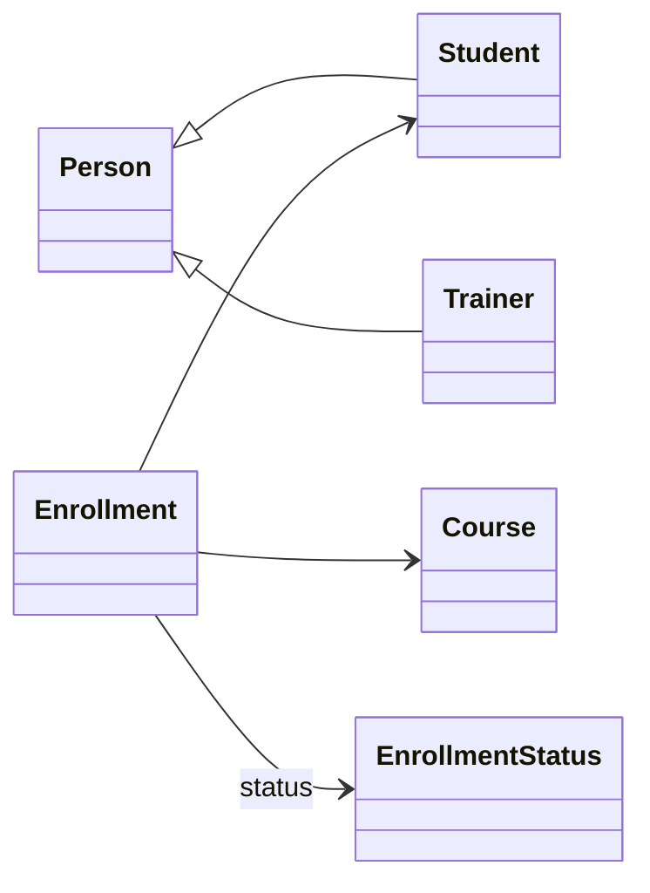
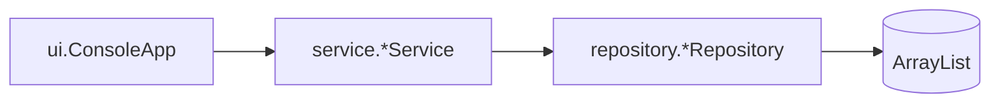

# LearnTrack

LearnTrack is a **console-based** Student & Course Management System built with **Core Java**. Admins manage students, courses, and enrollments through a menu-driven terminal UI. All data is stored in memory using `ArrayList`.

## Features

- **Students:** add, list (active only), search by ID (active or deactivated), update, deactivate, activate
- **Courses:** add, list (active only), activate / deactivate
- **Enrollments:** enroll, view by student, complete, cancel
- Custom exceptions, input validation, and layered design (entity → repository → service → UI)
- OOP: encapsulation, inheritance (`Person` → `Student` / `Trainer`), polymorphism (`getDisplayName`)

### Student visibility rules

| Action | Deactivated students |
|--------|----------------------|
| View all students | Hidden (active roster only) |
| Search student by ID | Shown (includes `Active: false`) |
| Update, enroll, deactivate, display name | Not allowed until reactivated |
| Activate student | Allowed by ID |

## Class diagram

### Domain model (entities)

Core classes and how they relate:



| Class | Role |
|-------|------|
| `Person` | Base type: id, name, email, active flag |
| `Student` / `Trainer` | Extend `Person` (inheritance + `getDisplayName()` override) |
| `Course` | Standalone course record |
| `Enrollment` | Links one student to one course |
| `EnrollmentStatus` | `ACTIVE`, `COMPLETED`, `CANCELLED` |

### Application structure (layers)

Request flow from the console menu to in-memory data:



`util` (`IdGenerator`, `InputValidator`) and `exception` types are used by services and repositories; see [Design notes](docs/Design_Notes.md) for detail.

## Prerequisites

- **JDK 21** (or compatible JDK 17+)
- **Apache Maven 3.9+** (or use the included `mvnw` wrapper)

## Compile and run

From the project root:

```bash
mvn clean compile
mvn exec:java
```

Or compile and run manually:

```bash
mvn clean package -DskipTests
java -cp target/classes com.airtribe.learntrack.ui.ConsoleApp
```

Run tests:

```bash
mvn test
```

## Package layout

| Package | Purpose |
|---------|---------|
| `entity` | Domain models (`Student`, `Course`, `Enrollment`, …) |
| `service` | Business logic |
| `repository` | In-memory `ArrayList` storage |
| `ui` | Console menus (`ConsoleApp`) |
| `exception` | `EntityNotFoundException`, `InvalidInputException` |
| `util` | `IdGenerator`, `InputValidator` |
| `docs` | Setup and design documentation |

## Documentation

- [Setup instructions](docs/Setup_Instructions.md)
- [JVM basics](docs/JVM_Basics.md)
- [Design notes](docs/Design_Notes.md)
